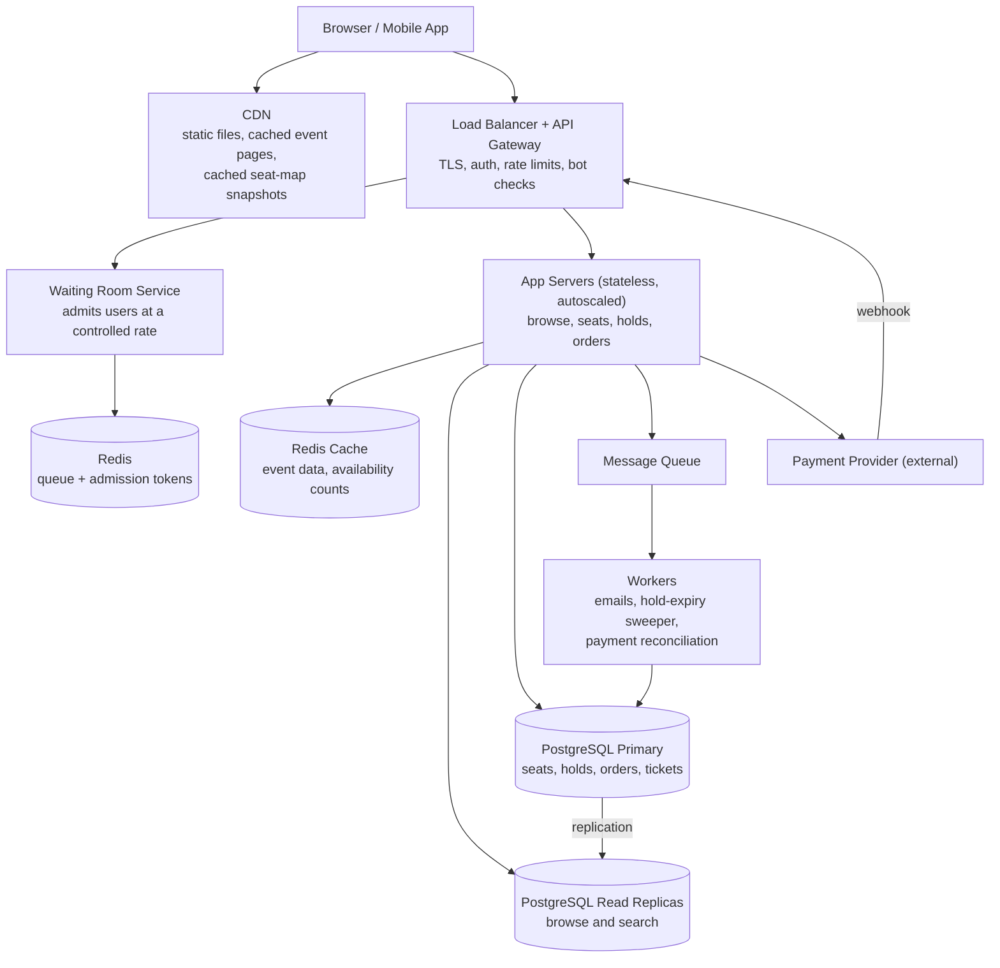

# TicketHub: System Design

TicketHub is a website that sells tickets for concerts and events. This document follows the six-part framework: requirements, estimates, API, data model, architecture, and trade-offs. Double-booking prevention has its own section because it is the most important correctness rule in the system.

---

## 1. Requirements

### Functional requirements

1. A user can register and log in.
2. A user can browse and search events (by name, city, date).
3. A user can view an event and its seat map with availability.
4. A user can **hold** one or more seats for a short time (10 minutes) while they pay.
5. A user can pay for held seats.
6. A user can view their tickets after purchase.
7. A user receives a confirmation email.
8. For very popular sales, users enter a **waiting room** before they can pick seats.

**Out of scope:** refunds (except automatic refunds for system errors), resale, organizer dashboards, seat-map editing.

### Non-functional requirements

| Quality | Requirement | Why it matters |
|---|---|---|
| **Speed** | Browsing pages: p95 < 300 ms. Holding seats: p95 < 500 ms. Payment confirmation shown within 5 s of the provider's response. | Slow pages lose buyers, and during a sale every second counts. |
| **Correctness** | A seat is **never sold to two people**. A payment never succeeds without a ticket, and a ticket never exists without a payment. A held seat cannot be taken by someone else until the hold expires. | Selling a seat twice means angry customers, refunds and lost trust. This is the hardest rule to keep. |
| **Fairness** | First come, first served among real people. No one can grab unlimited seats (max 6 per user per event). Bots and refresh-spamming must not beat normal users. | With 10 buyers per seat, the perception of an unfair sale damages the brand. |
| **Availability** | 99.9% normally, and the site must stay up during a big sale, even if it has to slow some users down. | A crash during the sale is the worst possible moment. |
| **Consistency** | Strong consistency for seats, holds and orders. Eventual consistency (a few seconds stale) is acceptable for browsing and seat-map display. | Only the seat decision must be exact. Everything else can be slightly old. |
| **Durability** | A confirmed order is never lost. | The user has paid. |
| **Security** | Card data never touches our servers (the payment provider handles it). Passwords hashed. HTTPS everywhere. | Legal and trust requirements. |

---

## 2. Estimates

Assumptions: 1 page view is roughly 1 request, a day has 86,400 seconds, and normal peak traffic is about 5x the daily average (evenings).

### Normal day

| Measure | Calculation | Result |
|---|---|---|
| Registered users | given | 2,000,000 |
| Daily visitors | given (2.5% of registered users) | 50,000 |
| Page views per day | 50,000 x 10 | **500,000** |
| Average requests/second | 500,000 / 86,400 | **about 6 req/s** |
| Peak requests/second | 6 x 5 | **about 30 req/s** |
| Tickets sold per day | given | 5,000 |
| Average ticket sales/second | 5,000 / 86,400 | **about 0.06/s** (peak about 0.3/s) |
| Orders per day | 5,000 tickets / about 2 tickets per order | about 2,500 |
| Browse-to-buy ratio | 5,000 tickets / 500,000 views | about 1% |
| New data per year | 5,000 x 365 = 1.8M tickets x about 1 KB (with order rows and indexes) | **about 2 GB/year** |

A normal day is easy: one small database and a few app servers handle it. Storage is also small. **The hard part of this system is concurrency, not volume.**

### Big sale (popular concert)

Given: 200,000 people try to buy 20,000 seats within the first 10 minutes (600 seconds).

| Measure | Calculation | Result |
|---|---|---|
| Users arriving per second (average) | 200,000 / 600 | **about 333 users/s** |
| Requests per user | event page, 3 seat-map refreshes, about 2 hold attempts, payment, status check (assumed) | about 10 |
| Total requests in 10 minutes | 200,000 x 10 | 2,000,000 |
| Average requests/second | 2,000,000 / 600 | **about 3,300 req/s** |
| Peak requests/second | 3,300 x 3 (the first minute is the busiest) | **about 10,000 req/s** |
| Hold attempts/second | 200,000 x 2 / 600 | about 670/s average, about 2,000/s at peak |
| Seats that can be sold | given | 20,000 |
| Buyers who succeed | 20,000 seats / about 2 seats each | about 10,000 of 200,000 = **5%** |
| Ticket sales rate | 20,000 / 600 s | **about 33 tickets/s** |
| Seat-map bandwidth if not cached | 20,000 seats, about 20 KB compressed x 10,000 req/s | about 200 MB/s (about 1.6 Gbps) |

### Comparison

| | Normal day | Big sale (10 min) | Ratio |
|---|---|---|---|
| Average requests/s | about 6 | about 3,300 | **about 550x** |
| Peak requests/s | about 30 | about 10,000 | **about 330x** |
| Tickets sold | 5,000 per day | 20,000 in 10 minutes | **4x a whole day's sales in 10 minutes** |
| Ticket sales/s | 0.06 | 33 | about 550x |
| Competing for the same rows | almost never | 10 buyers per seat, all at once | the real problem |

**Conclusions:**

1. Traffic is **hundreds of times** higher for 10 minutes. We cannot size the whole system for that permanently, so we need caching, a waiting room, and the ability to scale up before a known sale.
2. Most of this load is **reads** (seat maps). Reads can be cached and served by a CDN. Only the hold and payment **writes** (about 700 to 2,000/s) must hit the database, and a single PostgreSQL primary can handle that if the waiting room limits it.
3. About 95% of users will not get seats. The system must say "sold out" quickly and fairly, instead of letting them hammer the servers.

---

## 3. API

Base path: `/api/v1`. All endpoints return JSON. Endpoints that change data require a logged-in user (`Authorization: Bearer <token>`).

| # | Endpoint | Purpose |
|---|---|---|
| 1 | `POST /auth/login` | Log in, receive a token |
| 2 | `GET /events?query=&city=&from=&page=` | Browse and search events |
| 3 | `GET /events/{event_id}` | Event details (name, venue, date, price ranges) |
| 4 | `GET /events/{event_id}/seats?section=` | View the seat map with availability |
| 5 | `POST /events/{event_id}/queue` | Join the waiting room (for popular events) |
| 6 | `GET /events/{event_id}/queue/me` | Check my queue position / get my admission token |
| 7 | `POST /events/{event_id}/holds` | Hold seats for 10 minutes |
| 8 | `DELETE /holds/{hold_id}` | Release a hold early |
| 9 | `POST /orders` | Pay for a hold and create the order |
| 10 | `GET /orders/{order_id}` | Check order status |
| 11 | `GET /me/tickets` | View my tickets |
| 12 | `POST /payments/webhook` | Called by the payment provider to confirm payment |

### Key examples

**`GET /events/{event_id}/seats?section=A`** (cached for 1 to 2 seconds, so it may be slightly stale)

```json
{
  "event_id": 42,
  "as_of": "2026-10-20T18:00:02Z",
  "seats": [
    { "seat_id": 9001, "section": "A", "row": "1", "number": 5, "price_cents": 8000, "status": "AVAILABLE" },
    { "seat_id": 9002, "section": "A", "row": "1", "number": 6, "price_cents": 8000, "status": "HELD" }
  ]
}
```

**`POST /events/{event_id}/holds`**

Headers: `Authorization`, `Idempotency-Key: <uuid>`, `X-Admission-Token: <token>` (required for events with a waiting room)

```json
{ "seat_ids": [9001, 9003] }
```

| Result | Response |
|---|---|
| Success | `201 { "hold_id": 777, "expires_at": "2026-10-20T18:10:02Z" }` |
| A seat is taken | `409 { "error": "seat_unavailable", "unavailable": [9003] }` (nothing is held, all or nothing) |
| More than 6 seats | `422` |
| No valid admission token | `403` |
| Too many requests | `429` |

**`POST /orders`**

Headers: `Authorization`, `Idempotency-Key: <uuid>`

```json
{ "hold_id": 777, "payment_token": "tok_abc123" }
```

| Result | Response |
|---|---|
| Paid | `201 { "order_id": 555, "status": "PAID", "tickets": [ ... ] }` |
| Payment still processing | `202 { "order_id": 555, "status": "PENDING" }` (client polls `GET /orders/555`) |
| Hold expired | `410 { "error": "hold_expired" }` |
| Card declined | `402 { "error": "payment_failed" }` (hold is released) |

**`GET /me/tickets`** returns the user's tickets (`ticket_id`, event, seat, QR code value, status).

**Why the `Idempotency-Key`?** If a user double-clicks "Pay" or the network retries a request, the server recognises the same key and returns the first result instead of creating a second hold or charging twice.

---

## 4. Data Model

Database: **PostgreSQL** (relational, with transactions and constraints, which we need for correctness).

### Tables

```sql
CREATE TABLE users (
  id            BIGSERIAL PRIMARY KEY,
  email         TEXT NOT NULL UNIQUE,
  password_hash TEXT NOT NULL,
  name          TEXT NOT NULL,
  created_at    TIMESTAMPTZ NOT NULL DEFAULT now()
);

CREATE TABLE events (
  id          BIGSERIAL PRIMARY KEY,
  name        TEXT NOT NULL,
  venue       TEXT NOT NULL,
  city        TEXT NOT NULL,
  starts_at   TIMESTAMPTZ NOT NULL,
  on_sale_at  TIMESTAMPTZ NOT NULL,
  is_popular  BOOLEAN NOT NULL DEFAULT false   -- turns on the waiting room
);
CREATE INDEX ON events (city, starts_at);

CREATE TABLE seats (            -- one row per seat PER EVENT
  id              BIGSERIAL PRIMARY KEY,
  event_id        BIGINT NOT NULL REFERENCES events(id),
  section         TEXT NOT NULL,
  row_label       TEXT NOT NULL,
  seat_number     INT  NOT NULL,
  price_cents     INT  NOT NULL CHECK (price_cents >= 0),
  status          TEXT NOT NULL DEFAULT 'AVAILABLE'
                  CHECK (status IN ('AVAILABLE','HELD','SOLD')),
  hold_id         BIGINT REFERENCES holds(id),
  hold_expires_at TIMESTAMPTZ,
  UNIQUE (event_id, section, row_label, seat_number)
);
CREATE INDEX ON seats (event_id, status);

CREATE TABLE holds (
  id          BIGSERIAL PRIMARY KEY,
  user_id     BIGINT NOT NULL REFERENCES users(id),
  event_id    BIGINT NOT NULL REFERENCES events(id),
  status      TEXT NOT NULL CHECK (status IN ('ACTIVE','PAYING','EXPIRED','RELEASED','CONVERTED')),
  expires_at  TIMESTAMPTZ NOT NULL,
  created_at  TIMESTAMPTZ NOT NULL DEFAULT now()
);

CREATE TABLE orders (
  id               BIGSERIAL PRIMARY KEY,
  user_id          BIGINT NOT NULL REFERENCES users(id),
  event_id         BIGINT NOT NULL REFERENCES events(id),
  hold_id          BIGINT NOT NULL UNIQUE REFERENCES holds(id),  -- one order per hold
  idempotency_key  TEXT   NOT NULL UNIQUE,                       -- no double charges
  total_cents      INT    NOT NULL,
  status           TEXT   NOT NULL CHECK (status IN ('PENDING','PAID','FAILED','REFUNDED')),
  created_at       TIMESTAMPTZ NOT NULL DEFAULT now()
);

CREATE TABLE tickets (
  id        BIGSERIAL PRIMARY KEY,
  order_id  BIGINT NOT NULL REFERENCES orders(id),
  seat_id   BIGINT NOT NULL UNIQUE REFERENCES seats(id),   -- THE safety net: one ticket per seat, ever
  user_id   BIGINT NOT NULL REFERENCES users(id),
  qr_code   TEXT NOT NULL UNIQUE
);

CREATE TABLE payments (
  id            BIGSERIAL PRIMARY KEY,
  order_id      BIGINT NOT NULL REFERENCES orders(id),
  provider_ref  TEXT UNIQUE,            -- the provider's transaction id
  amount_cents  INT NOT NULL,
  status        TEXT NOT NULL CHECK (status IN ('PENDING','SUCCEEDED','FAILED','REFUNDED')),
  created_at    TIMESTAMPTZ NOT NULL DEFAULT now()
);
```

(`holds` is created before `seats` in the real migration order. It is listed after `seats` here for readability.)

### Relationships

```
users 1 ----< holds       (a user makes many holds)
users 1 ----< orders      (a user places many orders)
users 1 ----< tickets     (a user owns many tickets)
events 1 ----< seats      (an event has many seats; 20,000 for a big concert)
events 1 ----< holds
events 1 ----< orders
holds 1 ----< seats       (a hold covers several seats)
holds 1 ---- 1 orders     (a hold becomes at most one order)
orders 1 ----< tickets    (an order produces one ticket per seat)
orders 1 ----< payments   (an order may have more than one payment attempt)
seats 1 ---- 0..1 tickets (a seat has at most ONE ticket, enforced by UNIQUE(seat_id))
```

---

## 5. How double-booking is prevented

The goal: **if two people try to buy the same seat at the same moment, exactly one succeeds and the other gets a clear "seat unavailable" answer.**

The principle: **the application never "checks, then writes" in two separate steps.** A check-then-write is a race condition: two requests both read `AVAILABLE`, both decide to proceed, and both write. Instead, the database makes the check and the write **one atomic step**, and a constraint acts as a final safety net. We use four layers.

### Layer 1: Atomic conditional hold (transaction + row locks)

Holding seats is a single transaction:

```sql
BEGIN;

-- 1. Create the hold row (user, event, expires_at = now() + 10 minutes)
INSERT INTO holds (user_id, event_id, status, expires_at)
VALUES (:user, :event, 'ACTIVE', now() + interval '10 minutes')
RETURNING id;                                   -- :hold_id

-- 2. Claim the seats. The WHERE clause IS the availability check.
WITH picked AS (
  SELECT id FROM seats
  WHERE event_id = :event
    AND id = ANY(:seat_ids)
    AND (status = 'AVAILABLE'
         OR (status = 'HELD' AND hold_expires_at < now()))   -- expired holds count as free
  ORDER BY id                                   -- same lock order for everyone: no deadlocks
  FOR UPDATE SKIP LOCKED                        -- if someone else is claiming it, don't wait
)
UPDATE seats s
SET status = 'HELD', hold_id = :hold_id, hold_expires_at = now() + interval '10 minutes'
FROM picked
WHERE s.id = picked.id
RETURNING s.id;

-- 3. If the number of rows returned <> the number of seats requested: ROLLBACK and return 409.
--    Otherwise COMMIT.
COMMIT;
```

Why this works:

* `FOR UPDATE` puts a **row lock** on each candidate seat. Only one transaction at a time can hold the lock on a given seat.
* If two users go for seat 9001 at the same instant, one transaction gets the lock and marks the seat `HELD`. The other either skips the locked row (`SKIP LOCKED`) or, if it arrives later, no longer matches the `WHERE status = 'AVAILABLE'` condition. Either way it gets **zero rows** and the request fails with `409`.
* It is **all or nothing**. If a user asks for 3 seats and only 2 are free, the transaction rolls back and they hold nothing, so nobody is left with half an order.
* `SKIP LOCKED` means requests do not queue up behind a hot seat. They fail fast, which matters when 200,000 people are competing.
* Sorting by `id` means two transactions that want overlapping seats lock them in the same order, so they cannot deadlock.

### Layer 2: Holds expire safely

* A hold lasts 10 minutes. Expiry is checked **inside the query** (`hold_expires_at < now()`), so a seat becomes available again at the exact moment the hold expires, even if no cleanup job has run yet.
* A background worker also sweeps expired holds every 30 seconds and resets the seats to `AVAILABLE`, to keep the data tidy and the seat map accurate.

### Layer 3: Payment cannot race with expiry

When the user clicks Pay:

1. **Short transaction:** lock the hold row (`SELECT ... FOR UPDATE`), check that it belongs to this user, is `ACTIVE`, and has not expired. Then set it to `PAYING`, extend `expires_at` by 3 minutes (so the sweeper cannot release these seats while the card is being charged), and insert the `orders` row as `PENDING`. The `idempotency_key` UNIQUE constraint means a double-click cannot create two orders.
2. **Call the payment provider outside the transaction**, using the same idempotency key. We never hold database locks during a slow network call.
3. **On success** (from the provider's response or its webhook), run a second transaction: mark the order `PAID`, insert one `tickets` row per seat, and set each seat to `SOLD` (`UPDATE ... WHERE hold_id = :hold_id AND status = 'HELD'`, then verify the row count).
4. **On failure**, release the hold and its seats.

### Layer 4: A database constraint as the final safety net

`tickets.seat_id` is **UNIQUE**. Even if a bug in our code, a retry, or a race we did not think of tried to create a second ticket for the same seat, the database would reject the insert and the whole transaction would roll back. The rule "one ticket per seat" is enforced by the database itself, not just by careful application code.

### Failure cases

| Situation | What happens |
|---|---|
| Two users click the same seat at the same moment | One hold succeeds, the other gets `409`. |
| User double-clicks "Pay" or the network retries | The `Idempotency-Key` returns the same order. No second charge, no second order. |
| Hold expires while the user is typing card details | The seats may be given to someone else. The user gets `410` and nothing is charged. |
| Payment succeeds but our server crashes before writing the tickets | The provider's webhook and a reconciliation job complete the order. Seats stay protected, since the hold is `PAYING` and extended. If the order truly cannot be completed, the payment is automatically refunded. |
| App server dies in the middle of the hold transaction | The transaction rolls back automatically. No partial hold exists. |
| A stale cached seat map shows a taken seat as free | The user clicks it, the hold fails with `409`, and the UI refreshes. The cache is only a display hint. The database decides. |

**Redis is never the source of truth for seats.** It is used for caching and queues only. All decisions about who owns a seat are made in one place: the PostgreSQL primary.

---

## 6. Architecture



### Components

| Component | What it does | Why it is there |
|---|---|---|
| **Client (web / mobile)** | Shows events and the seat map, joins the waiting room, runs the hold countdown. | The user interface. It refreshes the seat map every few seconds, with random jitter so clients do not all refresh at once. |
| **CDN** | Serves static files (JS, CSS, images) and caches event pages and seat-map snapshots for 1 to 2 seconds. | Removes most of the read load. Without it the seat map alone would need about 1.6 Gbps at peak. |
| **Load balancer + API gateway** | Terminates HTTPS, spreads traffic across app servers, checks tokens, applies rate limits per user and IP, and blocks obvious bots. | Protects the system from overload and abuse, and enforces fairness (for example, 1 queue entry per user). |
| **Waiting room service** | When a popular sale opens, users join a queue and are let into the buying flow gradually. Admitted users get a signed, time-limited token that the hold and order endpoints require. | Turns 200,000 simultaneous users into a steady, limited flow (for example 2,000 active shoppers at a time). This is the main protection for the database. |
| **Redis (queue + tokens)** | Stores queue positions and admission tokens. | Very fast, and losing it only means re-queueing, not losing money or seats. |
| **App servers** | Stateless services that implement the API. No user state is stored in memory, so more servers can be added at any time. | Horizontal scaling. They are scaled up before a scheduled sale. |
| **Redis cache** | Caches event details and seat availability counts. | Keeps repeated reads off the database. |
| **PostgreSQL read replicas** | Serve browse and search queries. | Keep read traffic away from the primary. A few seconds of replication lag is acceptable here. |
| **PostgreSQL primary** | The single source of truth for seats, holds, orders and tickets. All seat-changing transactions run here. | Strong consistency and transactions are required for correctness (see section 5). |
| **Message queue** | Carries background jobs: send emails, generate tickets, and so on. | Keeps slow work out of the buying path so users get fast responses. |
| **Workers** | Send confirmation emails, release expired holds, and reconcile payments with the provider. | Handle everything that does not have to happen while the user waits. |
| **Payment provider** | Handles cards and mobile payments, and calls our webhook with the result. | We never store card data, which keeps us out of the heaviest security obligations. |

### How it survives the big sale

1. **Prepare in advance.** Sales are scheduled, so we know when the load is coming. Before `on_sale_at` we add app servers, warm the caches, pre-load the seat map into the CDN and Redis, and confirm the database is healthy.
2. **Absorb reads at the edge.** Event pages and the seat map are served by the CDN and Redis. A cached seat map may be 1 to 2 seconds old, which is fine because it is only a hint.
3. **Waiting room limits the writes.** Of about 10,000 req/s at peak, most is waiting-room and cached read traffic. Only admitted users (a few thousand at a time) reach the hold and order endpoints, so the primary database sees roughly hundreds of hold attempts per second, which one PostgreSQL primary can handle.
4. **Fail fast and cheaply.** `SKIP LOCKED` holds fail immediately instead of queueing. When the event sells out, a "sold out" flag is cached, and everyone still in the queue gets an instant answer without touching the database.
5. **Fairness controls.** Users who join in the first minutes after opening are admitted in randomised order, so a faster connection is not an advantage, and later arrivals are admitted in order of arrival. Each user gets one queue entry, a maximum of 6 seats, and rate limits at the gateway.
6. **Isolate slow work.** Emails and ticket generation happen through the queue, and the payment call is made outside database transactions, so a slow provider cannot freeze the seat tables.
7. **Degrade gracefully.** If load goes beyond expectations, the gateway sheds traffic with `429` and "please wait" pages. We choose to slow some users down rather than crash for all of them or risk wrong data.

---

## 7. Trade-offs

### Trade-off 1: Strong consistency for seats vs. speed and scalability

* **Choice:** all seat decisions go through one PostgreSQL primary with transactions and row locks.
* **Benefit:** it is simple to reason about and provably correct. A seat can never be sold twice.
* **Cost:** the primary is a single point of write scaling. It could become a bottleneck beyond a certain sale size, and a failure needs a failover.
* **Why we accept it:** correctness is our top requirement, and our estimates (about 700 to 2,000 hold attempts/s, kept lower by the waiting room) fit comfortably. If we grow, we can partition by `event_id`, because events do not share seats.

### Trade-off 2: Cached (slightly stale) seat map vs. an always-exact seat map

* **Choice:** the seat map is cached for 1 to 2 seconds in the CDN and Redis.
* **Benefit:** removes about 1.6 Gbps and thousands of queries per second from the database.
* **Cost:** a user may click a seat that was just taken and get a `409`. This is frustrating, though harmless.
* **Why we accept it:** an exact map for 200,000 people would crash the system. The cache is only a hint, so correctness is not affected.

### Trade-off 3: Waiting room (fairness and stability) vs. user experience and simplicity

* **Choice:** a virtual queue with randomised admission for the first few minutes.
* **Benefit:** protects the system and prevents the fastest connections and bots from winning every time.
* **Cost:** more components to build and run, and users must wait, with some leaving in frustration.
* **Why we accept it:** without it, 200,000 simultaneous users would either crash the site or favour whoever refreshes fastest. Predictable waiting is a better experience than a crash.

### Trade-off 4: Hold duration (10 minutes)

* **Short holds** free seats quickly for other buyers, but rush users and cause more failed payments.
* **Long holds** are comfortable for users, but let people (or bots) lock seats they never buy, which hurts other users and event revenue.
* **Choice:** 10 minutes, with an extension to 3 more minutes only once payment has actually started. This can be tuned per event from real data.

### Trade-off 5: Lazy expiry plus sweeper vs. only a cleanup job

* **Choice:** the hold query treats expired holds as free by itself, and a background sweeper tidies up as well.
* **Benefit:** seats are available at the exact moment of expiry, and correctness does not depend on a job running on time.
* **Cost:** slightly more complex SQL, and the seat-map display may briefly show an expired hold as `HELD` until the sweeper runs.
